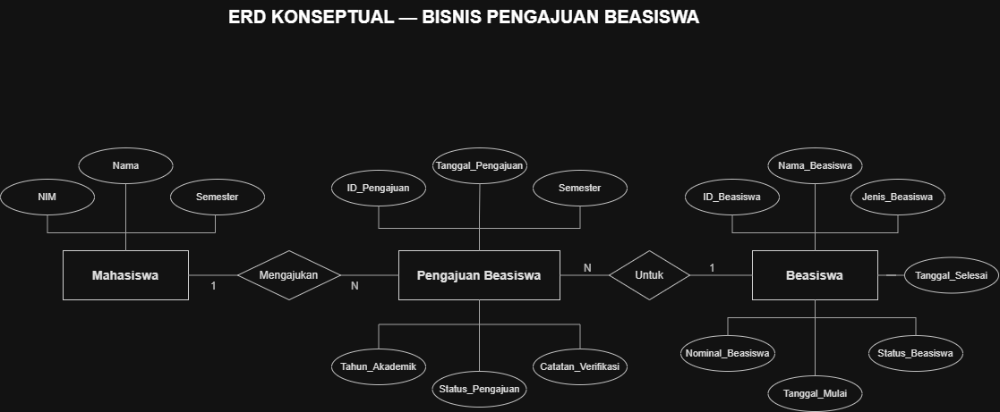
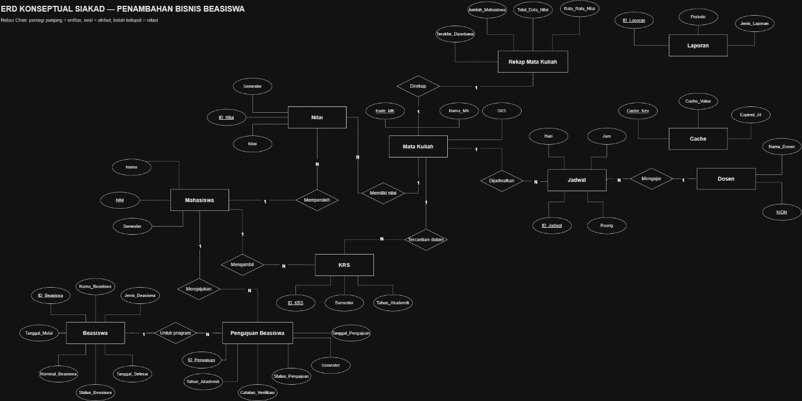
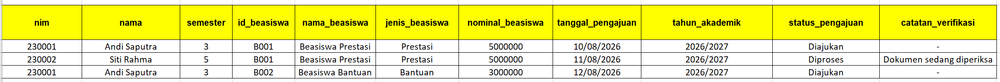
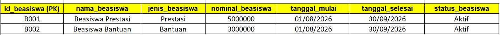
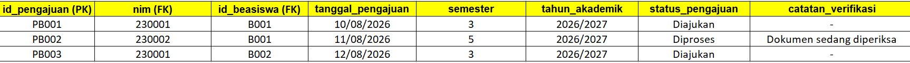
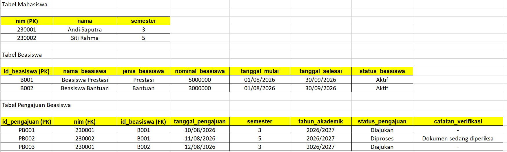

# LAPORAN PEMODELAN DATA TERSTRUKTUR SISTEM INFORMASI AKADEMIK (SIAKAD)
## Pengembangan Proses Bisnis Pengajuan Beasiswa Mahasiswa

---

# BAB I. PENDAHULUAN

## 1.1 Latar Belakang

Sistem Informasi Akademik (SIAKAD) merupakan sistem yang digunakan untuk mendukung pengelolaan data akademik perguruan tinggi, seperti data mahasiswa, dosen, mata kuliah, Kartu Rencana Studi (KRS), jadwal perkuliahan, dan nilai mahasiswa. Seiring dengan perkembangan kebutuhan perguruan tinggi, sistem informasi akademik perlu dikembangkan agar dapat mendukung proses bisnis tambahan yang sebelumnya belum tersedia.

Salah satu kebutuhan tambahan yang dapat diterapkan adalah proses pengajuan beasiswa mahasiswa. Proses pengajuan beasiswa memerlukan pengelolaan data yang terstruktur, mulai dari informasi program beasiswa, pengajuan oleh mahasiswa, pemeriksaan persyaratan, hingga penetapan status pengajuan.

Apabila proses tersebut tidak dikelola melalui sistem yang terintegrasi, pencatatan pengajuan berpotensi mengalami duplikasi data, kesulitan dalam memantau status pengajuan, dan ketidakteraturan penyimpanan informasi beasiswa.

Oleh karena itu, diperlukan pengembangan proses bisnis pengajuan beasiswa pada SIAKAD dengan menerapkan pemodelan data terstruktur melalui tiga tahapan, yaitu pemodelan konseptual menggunakan Entity-Relationship Diagram (ERD), pemodelan logis melalui skema relasional dan normalisasi, serta pemodelan fisik menggunakan SQL Data Definition Language (DDL).

## 1.2 Rumusan Masalah

1. Bagaimana merancang proses bisnis pengajuan beasiswa yang terintegrasi dengan SIAKAD?
2. Bagaimana mengidentifikasi entitas, atribut, dan hubungan antardata dalam proses pengajuan beasiswa?
3. Bagaimana mentransformasikan ERD menjadi skema relasional yang memenuhi normalisasi hingga bentuk normal ketiga (3NF)?
4. Bagaimana mengimplementasikan skema relasional ke dalam struktur tabel basis data menggunakan SQL DDL beserta primary key, foreign key, dan constraint validasi?

## 1.3 Tujuan

1. Menambahkan proses bisnis pengajuan beasiswa pada sistem SIAKAD.
2. Merancang model konseptual yang menggambarkan entitas dan hubungan antarentitas.
3. Menyusun skema relasional dan menerapkan normalisasi 1NF, 2NF, dan 3NF.
4. Membuat struktur tabel basis data menggunakan SQL DDL dengan aturan integritas data yang sesuai.

## 1.4 Ruang Lingkup

Pengembangan berfokus pada proses pengajuan beasiswa mahasiswa, yang meliputi:

- Pengelolaan informasi program beasiswa.
- Pencatatan pengajuan beasiswa oleh mahasiswa.
- Pemeriksaan dan verifikasi pengajuan.
- Pencatatan status persetujuan atau penolakan.
- Pengelolaan hubungan antara data mahasiswa, program beasiswa, dan pengajuan.

Sistem ini merupakan rancangan pengembangan berdasarkan ERD SIAKAD yang telah dibahas. Aturan khusus seperti besaran beasiswa, syarat IPK, dan batas jumlah penerima dapat disesuaikan dengan kebijakan perguruan tinggi.

---

# BAB II. ANALISIS DAN PERANCANGAN PROSES BISNIS

## 2.1 Analisis Proses Bisnis Sebelumnya

Sistem SIAKAD yang menjadi dasar pengembangan telah memiliki data akademik, seperti mahasiswa, mata kuliah, KRS, nilai, dosen, dan jadwal. Namun, proses bisnis pengajuan beasiswa belum tercakup dalam rancangan yang dibahas.

Oleh karena itu, diperlukan penambahan fitur yang memungkinkan mahasiswa mengajukan beasiswa dan pihak akademik mengelola hasil verifikasinya.

## 2.2 Proses Bisnis yang Diusulkan

Proses bisnis baru yang diusulkan adalah Pengajuan dan Verifikasi Beasiswa Mahasiswa, yang bertujuan untuk mempermudah pengelolaan program beasiswa, proses pengajuan oleh mahasiswa, serta verifikasi dan penyampaian hasil pengajuan secara terstruktur.

### Alur Proses Bisnis

1. **Pengelolaan Program Beasiswa**  
   Admin mengelola data program beasiswa, meliputi nama beasiswa, jenis beasiswa, nominal bantuan, persyaratan, serta periode pendaftaran.

2. **Pengajuan Beasiswa oleh Mahasiswa**  
   Mahasiswa memilih program beasiswa yang tersedia, kemudian mengisi formulir pengajuan dan melengkapi dokumen sesuai dengan persyaratan yang ditentukan.

3. **Validasi dan Verifikasi Pengajuan**  
   Petugas memeriksa kelengkapan dokumen serta kesesuaian persyaratan yang diajukan oleh mahasiswa. Apabila terdapat kekurangan, petugas dapat memberikan catatan untuk ditindaklanjuti.

4. **Penetapan Status Pengajuan**  
   Berdasarkan hasil verifikasi, petugas menetapkan status pengajuan beasiswa menjadi:
   - **Disetujui**, apabila mahasiswa memenuhi persyaratan.
   - **Ditolak**, apabila mahasiswa tidak memenuhi persyaratan yang ditentukan.

5. **Penyampaian Informasi Hasil Pengajuan**  
   Mahasiswa dapat melihat status pengajuan beasiswa beserta catatan hasil verifikasi melalui sistem informasi. Dengan demikian, mahasiswa dapat mengetahui hasil pengajuan secara transparan.

### Hasil yang Diharapkan

Dengan adanya proses bisnis ini, pengelolaan beasiswa diharapkan menjadi lebih efektif, terstruktur, dan transparan. Selain itu, sistem dapat membantu petugas dalam memverifikasi pengajuan serta memudahkan mahasiswa dalam memantau status pengajuan beasiswa.

## 2.3 Aturan Bisnis

Aturan bisnis yang diterapkan dalam rancangan ini adalah:

1. Setiap program beasiswa memiliki identitas dan informasi tersendiri.
2. Setiap pengajuan harus berasal dari satu mahasiswa yang terdaftar di SIAKAD.
3. Setiap pengajuan ditujukan kepada satu program beasiswa.
4. Satu mahasiswa dapat mengajukan program beasiswa yang berbeda.
5. Mahasiswa tidak boleh memiliki pengajuan ganda untuk program beasiswa yang sama pada tahun akademik yang sama.
6. Setiap pengajuan memiliki tanggal pengajuan dan status proses.
7. Status pengajuan dapat berupa Diajukan, Diproses, Disetujui, atau Ditolak.
8. Catatan verifikasi digunakan untuk mencatat alasan atau hasil pemeriksaan petugas.
9. Program beasiswa hanya dapat diajukan apabila statusnya aktif dan tanggal pengajuan berada dalam periode pendaftaran.
10. Data pengajuan harus merujuk pada data mahasiswa dan program beasiswa yang valid.

Aturan pada poin 9 memerlukan validasi tambahan pada logika aplikasi atau trigger karena tidak seluruh aturan lintas kolom dapat ditegakkan hanya dengan CHECK pada tabel pengajuan.

---

# BAB III. PEMODELAN KONSEPTUAL

## 3.1 Identifikasi Entitas

Pemodelan konseptual bertujuan mengidentifikasi entitas yang terlibat dalam proses bisnis serta atribut dan hubungan antarentitas. Berdasarkan rancangan SIAKAD dan penambahan proses bisnis pengajuan beasiswa, entitas yang digunakan adalah sebagai berikut.

| No. | Entitas | Fungsi |
| :---: | :--- | :--- |
| 1 | Mahasiswa | Menyimpan identitas mahasiswa yang dapat mengajukan beasiswa. |
| 2 | Beasiswa | Menyimpan informasi program beasiswa yang tersedia. |
| 3 | Pengajuan Beasiswa | Mencatat pengajuan mahasiswa dan status verifikasinya. |
| 4 | Petugas Akademik | Peran yang melakukan verifikasi pengajuan beasiswa. |

Entitas Mahasiswa merupakan entitas yang telah ada pada SIAKAD. Entitas Beasiswa dan Pengajuan Beasiswa merupakan entitas baru. Petugas Akademik dapat menggunakan entitas Dosen yang telah ada apabila dosen memang bertugas sebagai verifikator, atau menggunakan entitas pengguna/petugas tersendiri apabila pengelolaan dilakukan oleh staf administrasi.

Untuk menjaga rancangan tetap sederhana, implementasi awal menggunakan tiga tabel inti: mahasiswa, beasiswa, dan pengajuan_beasiswa. Identitas petugas belum disimpan sebagai foreign key karena struktur tabel pengguna dan kewenangan verifikator pada sistem awal belum diketahui.

## 3.2 Identifikasi Atribut

### A. Entitas Mahasiswa

| Atribut | Keterangan |
| :--- | :--- |
| nim | Primary key dan identitas unik mahasiswa. |
| nama | Nama mahasiswa. |
| semester | Semester mahasiswa saat ini. |

Atribut tersebut mengikuti struktur dasar pada ERD awal. Atribut lain dapat dipertahankan sesuai database SIAKAD yang digunakan.

### B. Entitas Beasiswa

| Atribut | Keterangan |
| :--- | :--- |
| id_beasiswa | Primary key program beasiswa. |
| nama_beasiswa | Nama program beasiswa. |
| jenis_beasiswa | Kategori beasiswa. |
| nominal_beasiswa | Nilai dana beasiswa. |
| tanggal_mulai | Tanggal awal pendaftaran. |
| tanggal_selesai | Batas akhir pendaftaran. |
| status_beasiswa | Status program, aktif atau tidak aktif. |

### C. Entitas Pengajuan Beasiswa

| Atribut | Keterangan |
| :--- | :--- |
| id_pengajuan | Primary key pengajuan. |
| nim | Foreign key yang merujuk pada mahasiswa. |
| id_beasiswa | Foreign key yang merujuk pada program beasiswa. |
| tanggal_pengajuan | Tanggal mahasiswa mengajukan beasiswa. |
| semester | Semester saat pengajuan dilakukan. |
| tahun_akademik | Tahun akademik pengajuan. |
| status_pengajuan | Status proses pengajuan. |
| catatan_verifikasi | Catatan hasil pemeriksaan. |

## 3.3 Perubahan terhadap ERD Awal

Penambahan proses bisnis tidak menggantikan tabel SIAKAD yang telah ada. Perubahan dilakukan dengan mempertahankan entitas lama dan menambahkan dua entitas baru.

1. Menambahkan tabel beasiswa untuk menyimpan informasi program.
2. Menambahkan tabel pengajuan_beasiswa untuk menyimpan transaksi pengajuan.
3. Menghubungkan pengajuan_beasiswa.nim dengan mahasiswa.nim.
4. Menghubungkan pengajuan_beasiswa.id_beasiswa dengan beasiswa.id_beasiswa.

ERD berikut menunjukkan hubungan antara data mahasiswa, program beasiswa, dan pengajuan beasiswa.



Penjelasan kardinalitas:
- Mahasiswa ke Pengajuan Beasiswa: satu mahasiswa dapat mempunyai nol atau banyak pengajuan, sedangkan setiap pengajuan hanya dimiliki oleh satu mahasiswa.
- Beasiswa ke Pengajuan Beasiswa: satu program beasiswa dapat mempunyai nol atau banyak pengajuan, sedangkan setiap pengajuan hanya ditujukan kepada satu program beasiswa.

Dengan demikian, hubungan Mahasiswa dan Beasiswa secara konseptual adalah many-to-many yang direalisasikan melalui entitas Pengajuan Beasiswa.

## 3.4 Entity-Relationship Diagram (ERD)

Berikut adalah ERD sistem secara keseluruhan.



---

# BAB IV. PEMODELAN LOGIS

Normalisasi basis data dilakukan untuk mengurangi redundansi data, menjaga konsistensi data, serta memastikan struktur tabel sesuai dengan aturan normalisasi. Proses normalisasi pada sistem Pengajuan dan Verifikasi Beasiswa Mahasiswa dilakukan melalui empat tahap, yaitu UNF, 1NF, 2NF, dan 3NF.

## 1. Unnormalized Form (UNF)

Unnormalized Form (UNF) merupakan bentuk data awal yang belum dinormalisasi. Pada tahap ini, data pengajuan beasiswa masih memiliki kelompok data berulang dalam satu kolom.

### Tabel Pengajuan Beasiswa UNF

| nim | nama | semester | data_pengajuan_beasiswa |
| :--- | :--- | :--- | :--- |
| 230001 | Andi Saputra | 3 | (B001, Beasiswa Prestasi, Prestasi, 5000000, 10-08-2026, Diajukan); (B002, Beasiswa Bantuan, Bantuan, 3000000, 12-08-2026, Diajukan) |
| 230002 | Siti Rahma | 5 | (B001, Beasiswa Prestasi, Prestasi, 5000000, 11-08-2026, Diproses) |

Pada tabel UNF, satu mahasiswa dapat memiliki beberapa pengajuan beasiswa yang disimpan dalam satu kolom. Oleh karena itu, data perlu dipecah menjadi nilai-nilai atomik pada tahap 1NF.

## 2. First Normal Form (1NF)

First Normal Form (1NF) menghilangkan kelompok data berulang dengan memastikan setiap kolom berisi satu nilai atomik. Setiap pengajuan beasiswa dicatat dalam baris tersendiri.

### Tabel Pengajuan Beasiswa 1NF

| nim | nama | semester | id_beasiswa | nama_beasiswa | jenis_beasiswa | nominal_beasiswa | tanggal_pengajuan | tahun_akademik | status_pengajuan | catatan_verifikasi |
| :--- | :--- | :---: | :--- | :--- | :--- | :---: | :---: | :---: | :---: | :--- |
| 230001 | Andi Saputra | 3 | B001 | Beasiswa Prestasi | Prestasi | 5000000 | 10/08/2026 | 2026/2027 | Diajukan | - |
| 230002 | Siti Rahma | 5 | B001 | Beasiswa Prestasi | Prestasi | 5000000 | 11/08/2026 | 2026/2027 | Diproses | Dokumen sedang diperiksa |
| 230001 | Andi Saputra | 3 | B002 | Beasiswa Bantuan | Bantuan | 3000000 | 12/08/2026 | 2026/2027 | Diajukan | - |



Pada tahap ini, setiap data pengajuan telah dicatat dalam baris terpisah. Namun, masih terdapat pengulangan informasi mahasiswa dan informasi program beasiswa.

## 3. Second Normal Form (2NF)

Second Normal Form (2NF) menghilangkan ketergantungan parsial, yaitu ketika atribut non-key hanya bergantung pada sebagian dari kunci utama gabungan. Data mahasiswa, program beasiswa, dan transaksi pengajuan dipisahkan ke tabel masing-masing.

### Tabel Mahasiswa

| nim (PK) | nama | semester |
| :--- | :--- | :--- |
| 230001 | Andi Saputra | 3 |
| 230002 | Siti Rahma | 5 |

### Tabel Beasiswa

| id_beasiswa (PK) | nama_beasiswa | jenis_beasiswa | nominal_beasiswa | tanggal_mulai | tanggal_selesai | status_beasiswa |
| :--- | :--- | :--- | :---: | :---: | :---: | :---: |
| B001 | Beasiswa Prestasi | Prestasi | 5000000 | 01/08/2026 | 30/09/2026 | Aktif |
| B002 | Beasiswa Bantuan | Bantuan | 3000000 | 01/08/2026 | 30/09/2026 | Aktif |



### Tabel Pengajuan Beasiswa

| id_pengajuan (PK) | nim (FK) | id_beasiswa (FK) | tanggal_pengajuan | semester | tahun_akademik | status_pengajuan | catatan_verifikasi |
| :--- | :--- | :--- | :---: | :---: | :---: | :--- |
| PB001 | 230001 | B001 | 10/08/2026 | 3 | 2026/2027 | Diajukan | - |
| PB002 | 230002 | B001 | 11/08/2026 | 5 | 2026/2027 | Diproses | Dokumen sedang diperiksa |
| PB003 | 230001 | B002 | 12/08/2026 | 3 | 2026/2027 | Diajukan | - |



## 4. Third Normal Form (3NF)

Third Normal Form (3NF) menghilangkan ketergantungan transitif (transitive dependency). Artinya, atribut non-kunci harus bergantung langsung pada primary key, bukan pada atribut non-kunci lainnya.

Pada rancangan ini, informasi mahasiswa disimpan dalam tabel mahasiswa, sedangkan informasi program beasiswa disimpan dalam tabel beasiswa. Tabel pengajuan_beasiswa hanya menyimpan identitas mahasiswa, identitas beasiswa, dan informasi transaksi pengajuan.

Setelah pemeriksaan, struktur 2NF yang sudah memisahkan ketiga jenis data tersebut sudah memenuhi 3NF, dengan asumsi tidak ada ketergantungan lain yang belum dicantumkan. Karena itu, struktur tabel akhirnya tetap sama dengan hasil 2NF.



## 5. Skema Relasional Akhir

Struktur akhir basis data untuk modul Pengajuan dan Verifikasi Beasiswa Mahasiswa adalah sebagai berikut.

1. mahasiswa (nim [PK], nama, semester)
2. beasiswa (id_beasiswa [PK], nama_beasiswa, jenis_beasiswa, nominal_beasiswa, tanggal_mulai, tanggal_selesai, status_beasiswa)
3. pengajuan_beasiswa (id_pengajuan [PK], nim [FK], id_beasiswa [FK], tanggal_pengajuan, semester, tahun_akademik, status_pengajuan, catatan_verifikasi)

Relasi antartabel:
- Satu mahasiswa dapat memiliki banyak pengajuan beasiswa.
- Satu program beasiswa dapat memiliki banyak pengajuan.
- pengajuan_beasiswa.nim mengacu pada mahasiswa.nim.
- pengajuan_beasiswa.id_beasiswa mengacu pada beasiswa.id_beasiswa.

---

# BAB V. PEMODELAN FISIK

## 5.1 Implementasi Basis Data Menggunakan SQL DDL

Pemodelan fisik merupakan tahap menerjemahkan skema relasional ke dalam tabel basis data yang dapat diimplementasikan. Pada tahap ini, tipe data, primary key, foreign key, serta constraint ditentukan untuk menjaga integritas data.

Implementasi berikut menggunakan MySQL:

```sql
-- =========================================================
-- PEMODELAN FISIK BASIS DATA SIAKAD
-- DBMS: MySQL 8.0+
-- =========================================================

CREATE DATABASE IF NOT EXISTS siakad
    CHARACTER SET utf8mb4
    COLLATE utf8mb4_0900_ai_ci;

USE siakad;

-- 1. TABEL CACHE
CREATE TABLE IF NOT EXISTS cache (
    cache_key VARCHAR(255) NOT NULL,
    cache_value MEDIUMTEXT NOT NULL,
    expired_at DATETIME NULL,
    PRIMARY KEY (cache_key)
) ENGINE=InnoDB;

-- 2. TABEL DOSEN
CREATE TABLE IF NOT EXISTS dosen (
    nidn INT NOT NULL,
    nama_dosen VARCHAR(100) NOT NULL,
    PRIMARY KEY (nidn),
    CONSTRAINT chk_nama_dosen
        CHECK (CHAR_LENGTH(TRIM(nama_dosen)) > 0)
) ENGINE=InnoDB;

-- 3. TABEL MAHASISWA
CREATE TABLE IF NOT EXISTS mahasiswa (
    nim VARCHAR(100) NOT NULL,
    nama VARCHAR(100) NOT NULL,
    semester INT NOT NULL,
    PRIMARY KEY (nim),
    CONSTRAINT chk_semester_mahasiswa
        CHECK (semester BETWEEN 1 AND 14),
    CONSTRAINT chk_nama_mahasiswa
        CHECK (CHAR_LENGTH(TRIM(nama)) > 0)
) ENGINE=InnoDB;

-- 4. TABEL MATA KULIAH
CREATE TABLE IF NOT EXISTS matkul (
    kode_mk VARCHAR(20) NOT NULL,
    nama_mk VARCHAR(100) NOT NULL,
    sks INT NOT NULL,
    PRIMARY KEY (kode_mk),
    CONSTRAINT chk_sks
        CHECK (sks BETWEEN 1 AND 6),
    CONSTRAINT chk_nama_mk
        CHECK (CHAR_LENGTH(TRIM(nama_mk)) > 0)
) ENGINE=InnoDB;

-- 5. TABEL JADWAL
CREATE TABLE IF NOT EXISTS jadwal (
    id_jadwal INT NOT NULL AUTO_INCREMENT,
    hari VARCHAR(10) NOT NULL,
    jam TIME NOT NULL,
    ruang VARCHAR(50) NOT NULL,
    kode_mk VARCHAR(20) NOT NULL,
    nidn INT NOT NULL,
    PRIMARY KEY (id_jadwal),
    INDEX idx_jadwal_kode_mk (kode_mk),
    INDEX idx_jadwal_nidn (nidn),
    CONSTRAINT chk_hari
        CHECK (hari IN (
            'Senin', 'Selasa', 'Rabu', 'Kamis',
            'Jumat', 'Sabtu', 'Minggu'
        )),
    CONSTRAINT chk_ruang
        CHECK (CHAR_LENGTH(TRIM(ruang)) > 0),
    CONSTRAINT fk_jadwal_matkul
        FOREIGN KEY (kode_mk)
        REFERENCES matkul(kode_mk)
        ON UPDATE CASCADE ON DELETE RESTRICT,
    CONSTRAINT fk_jadwal_dosen
        FOREIGN KEY (nidn)
        REFERENCES dosen(nidn)
        ON UPDATE CASCADE ON DELETE RESTRICT
) ENGINE=InnoDB;

-- 6. TABEL KRS
CREATE TABLE IF NOT EXISTS krs (
    id_krs INT NOT NULL AUTO_INCREMENT,
    nim VARCHAR(100) NOT NULL,
    kode_mk VARCHAR(20) NOT NULL,
    semester VARCHAR(20) NOT NULL,
    tahun_akademik VARCHAR(20) NOT NULL,
    PRIMARY KEY (id_krs),
    INDEX idx_krs_nim (nim),
    INDEX idx_krs_kode_mk (kode_mk),
    CONSTRAINT fk_krs_mahasiswa
        FOREIGN KEY (nim)
        REFERENCES mahasiswa(nim)
        ON UPDATE CASCADE ON DELETE RESTRICT,
    CONSTRAINT fk_krs_matkul
        FOREIGN KEY (kode_mk)
        REFERENCES matkul(kode_mk)
        ON UPDATE CASCADE ON DELETE RESTRICT,
    CONSTRAINT uq_krs_mahasiswa_matkul
        UNIQUE (nim, kode_mk, semester, tahun_akademik),
    CONSTRAINT chk_krs_semester
        CHECK (CHAR_LENGTH(TRIM(semester)) > 0),
    CONSTRAINT chk_krs_tahun_akademik
        CHECK (CHAR_LENGTH(TRIM(tahun_akademik)) > 0)
) ENGINE=InnoDB;

-- 7. TABEL LAPORAN
CREATE TABLE IF NOT EXISTS laporan (
    id_laporan INT NOT NULL AUTO_INCREMENT,
    periode VARCHAR(50) NOT NULL,
    jenis_laporan VARCHAR(100) NOT NULL,
    PRIMARY KEY (id_laporan),
    CONSTRAINT chk_periode_laporan
        CHECK (CHAR_LENGTH(TRIM(periode)) > 0),
    CONSTRAINT chk_jenis_laporan
        CHECK (CHAR_LENGTH(TRIM(jenis_laporan)) > 0)
) ENGINE=InnoDB;

-- 8. TABEL NILAI
CREATE TABLE IF NOT EXISTS nilai (
    id_nilai INT NOT NULL AUTO_INCREMENT,
    nim VARCHAR(100) NOT NULL,
    kode_mk VARCHAR(20) NOT NULL,
    nilai DECIMAL(5,2) NOT NULL,
    semester VARCHAR(20) NOT NULL,
    PRIMARY KEY (id_nilai),
    INDEX idx_nilai_nim (nim),
    INDEX idx_nilai_kode_mk (kode_mk),
    CONSTRAINT fk_nilai_mahasiswa
        FOREIGN KEY (nim)
        REFERENCES mahasiswa(nim)
        ON UPDATE CASCADE ON DELETE RESTRICT,
    CONSTRAINT fk_nilai_matkul
        FOREIGN KEY (kode_mk)
        REFERENCES matkul(kode_mk)
        ON UPDATE CASCADE ON DELETE RESTRICT,
    CONSTRAINT chk_nilai
        CHECK (nilai BETWEEN 0 AND 100),
    CONSTRAINT chk_nilai_semester
        CHECK (CHAR_LENGTH(TRIM(semester)) > 0)
) ENGINE=InnoDB;

-- 9. TABEL REKAP MATA KULIAH
CREATE TABLE IF NOT EXISTS rekap_matkul (
    kode_mk VARCHAR(20) NOT NULL,
    nama_mk VARCHAR(100) NOT NULL,
    jumlah_mahasiswa INT NOT NULL DEFAULT 0,
    rata_rata_nilai DECIMAL(5,2) NULL,
    total_data_nilai INT NOT NULL DEFAULT 0,
    terakhir_diperbarui DATETIME NOT NULL
        DEFAULT CURRENT_TIMESTAMP
        ON UPDATE CURRENT_TIMESTAMP,
    PRIMARY KEY (kode_mk),
    CONSTRAINT fk_rekap_matkul
        FOREIGN KEY (kode_mk)
        REFERENCES matkul(kode_mk)
        ON UPDATE CASCADE ON DELETE RESTRICT,
    CONSTRAINT chk_jumlah_mahasiswa
        CHECK (jumlah_mahasiswa >= 0),
    CONSTRAINT chk_rata_rata_nilai
        CHECK (
            rata_rata_nilai IS NULL
            OR rata_rata_nilai BETWEEN 0 AND 100
        ),
    CONSTRAINT chk_total_data_nilai
        CHECK (total_data_nilai >= 0)
) ENGINE=InnoDB;

-- 10. TABEL BEASISWA
CREATE TABLE IF NOT EXISTS beasiswa (
    id_beasiswa VARCHAR(20) NOT NULL,
    nama_beasiswa VARCHAR(100) NOT NULL,
    jenis_beasiswa VARCHAR(50) NOT NULL,
    nominal_beasiswa DECIMAL(12,2) NOT NULL,
    tanggal_mulai DATE NOT NULL,
    tanggal_selesai DATE NOT NULL,
    status_beasiswa VARCHAR(20) NOT NULL DEFAULT 'Aktif',
    PRIMARY KEY (id_beasiswa),
    CONSTRAINT chk_nominal_beasiswa
        CHECK (nominal_beasiswa >= 0),
    CONSTRAINT chk_periode_beasiswa
        CHECK (tanggal_selesai >= tanggal_mulai),
    CONSTRAINT chk_status_beasiswa
        CHECK (status_beasiswa IN ('Aktif', 'Tidak Aktif')),
    CONSTRAINT chk_nama_beasiswa
        CHECK (CHAR_LENGTH(TRIM(nama_beasiswa)) > 0)
) ENGINE=InnoDB;

-- 11. TABEL PENGAJUAN BEASISWA
CREATE TABLE IF NOT EXISTS pengajuan_beasiswa (
    id_pengajuan VARCHAR(20) NOT NULL,
    nim VARCHAR(100) NOT NULL,
    id_beasiswa VARCHAR(20) NOT NULL,
    tanggal_pengajuan DATE NOT NULL,
    semester VARCHAR(20) NOT NULL,
    tahun_akademik VARCHAR(20) NOT NULL,
    status_pengajuan VARCHAR(20) NOT NULL DEFAULT 'Diajukan',
    catatan_verifikasi TEXT NULL,
    PRIMARY KEY (id_pengajuan),
    INDEX idx_pengajuan_nim (nim),
    INDEX idx_pengajuan_id_beasiswa (id_beasiswa),
    CONSTRAINT fk_pengajuan_mahasiswa
        FOREIGN KEY (nim)
        REFERENCES mahasiswa(nim)
        ON UPDATE CASCADE ON DELETE RESTRICT,
    CONSTRAINT fk_pengajuan_beasiswa
        FOREIGN KEY (id_beasiswa)
        REFERENCES beasiswa(id_beasiswa)
        ON UPDATE CASCADE ON DELETE RESTRICT,
    CONSTRAINT chk_status_pengajuan
        CHECK (
            status_pengajuan IN (
                'Diajukan', 'Diproses', 'Disetujui', 'Ditolak'
            )
        ),
    CONSTRAINT chk_semester_pengajuan
        CHECK (CHAR_LENGTH(TRIM(semester)) > 0),
    CONSTRAINT chk_tahun_akademik_pengajuan
        CHECK (CHAR_LENGTH(TRIM(tahun_akademik)) > 0),
    CONSTRAINT uq_pengajuan_beasiswa
        UNIQUE (nim, id_beasiswa, tahun_akademik)
) ENGINE=InnoDB;
```
