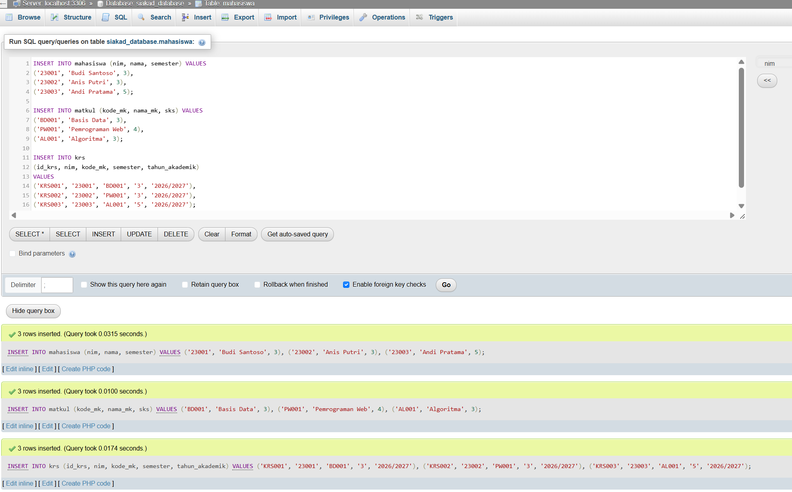
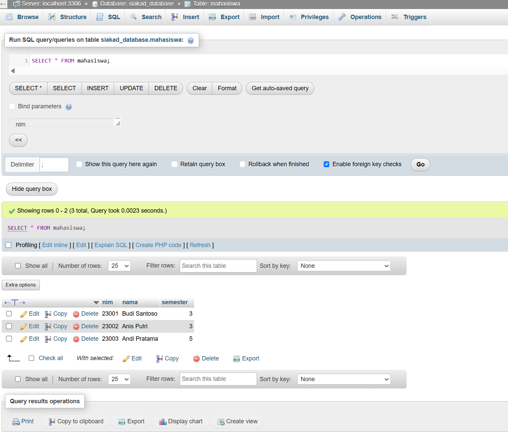
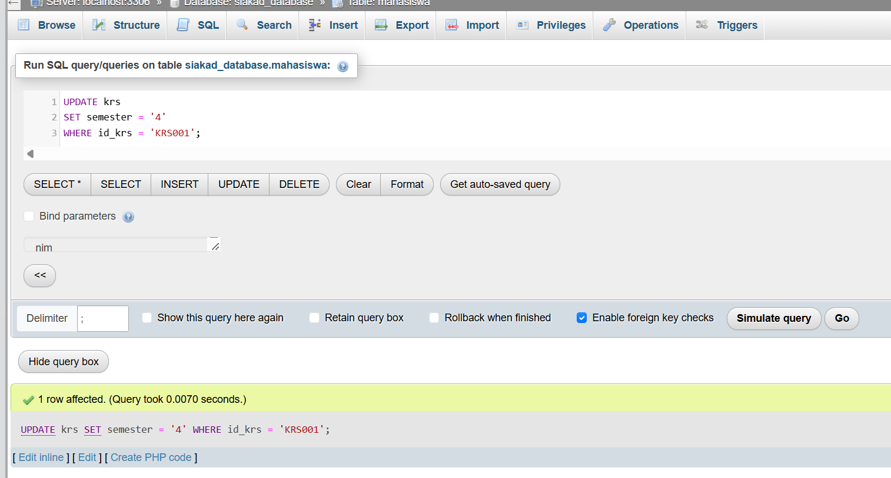
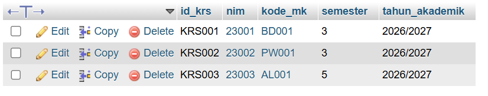
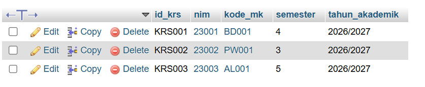
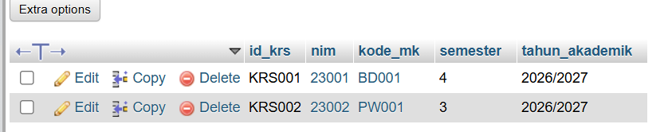

# SOAL 2: Operasi CRUD Dasar
**Bobot: 50% — SCPMK0720802 (CRUD Dasar)**

## Soal

Manipulasi baris data dasar.

Berdasarkan 3 tabel yang telah dibuat pada Soal 1, lakukan urutan operasi berikut menggunakan kode SQL:

1. **[CREATE]** Lakukan `INSERT` minimal 3 baris data dummy ke masing-masing tabel (total 9 baris data).
2. **[READ]** Tampilkan seluruh isi salah satu tabel induk menggunakan perintah `SELECT *`.
3. **[UPDATE]** Ubah satu nilai data pada tabel transaksi. Wajib menggunakan klausa `WHERE` pada *Primary Key* agar tidak terjadi *update* massal.
4. **[DELETE]** Hapus salah satu baris data dummy pada tabel transaksi. Wajib menggunakan klausa `WHERE`.

## Jawaban dan Hasil

### 1. CREATE — Menambahkan Data

Melakukan operasi `INSERT` untuk menambahkan minimal 3 baris data dummy ke masing-masing tabel, yaitu mahasiswa, matkul, dan KRS.

### 2. READ — Menampilkan Data

Menampilkan seluruh isi tabel induk mahasiswa menggunakan perintah `SELECT *`.

### 3. UPDATE — Mengubah Data

Mengubah nilai semester pada tabel KRS berdasarkan Primary Key `id_krs` agar hanya satu baris data yang diperbarui.

#### 3.1. Data Sebelum Diperbarui

#### 3.2. Data Setelah Diperbarui

### 4. DELETE — Menghapus Data

Menghapus salah satu baris data dummy pada tabel KRS berdasarkan Primary Key `id_krs` agar hanya data yang ditentukan yang dihapus.

#### 4.1. Data Sebelum Dihapus

#### 4.2. Data Setelah Dihapus

