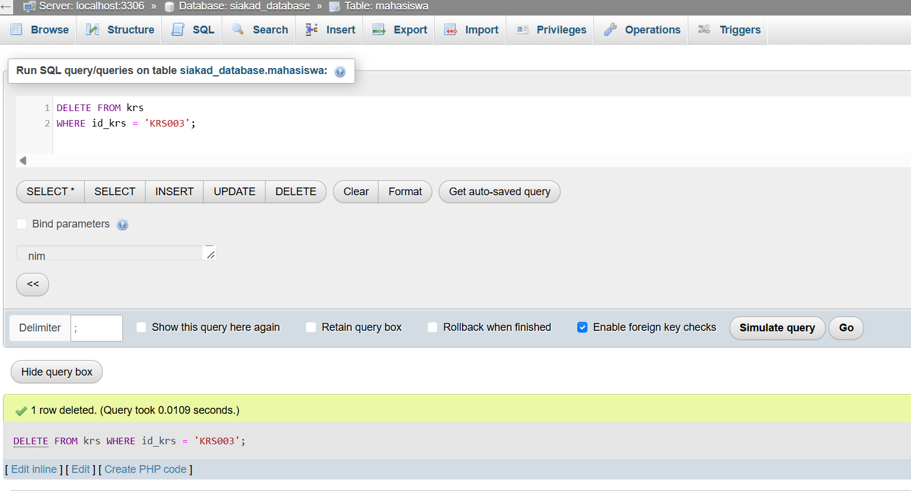

# SOAL 2: Operasi CRUD Dasar
**Bobot: 50% — SCPMK0720802 (CRUD Dasar)**

## Jawaban dan Hasil

### 1. CREATE — Menambahkan Data

Melakukan operasi `INSERT` untuk menambahkan minimal 3 baris data dummy ke masing-masing tabel, yaitu mahasiswa, matkul, dan KRS.

### 2. READ — Menampilkan Data

Menampilkan seluruh isi tabel induk mahasiswa menggunakan perintah `SELECT *`.

### 3. UPDATE — Mengubah Data

Mengubah nilai semester pada tabel KRS dengan menggunakan klausa `WHERE` berdasarkan Primary Key `id_krs` agar hanya satu baris data yang diperbarui.

**3.1. Data sebelum diperbarui**

**3.2. Data setelah diperbarui**

### 4. DELETE — Menghapus Data

Menghapus salah satu baris data dummy pada tabel KRS menggunakan klausa `WHERE` berdasarkan Primary Key `id_krs` agar hanya data yang ditentukan yang dihapus.

**4.1. Data sebelum dihapus**

**4.2. Data setelah dihapus**

