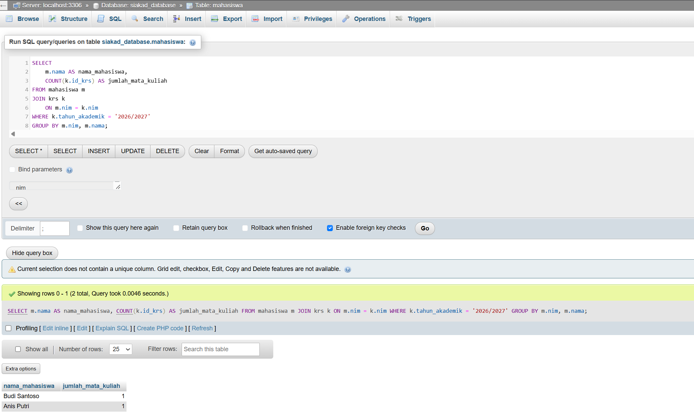

# SOAL 3: Query Kompleks & Agregasi Laporan
**Bobot: 10% — SCPMK0720803 (WHERE, JOIN, Aggregasi)**

## Soal

Sistem aplikasi proyek membutuhkan sebuah **Laporan Ringkasan**.

Buatlah satu perintah SQL (*query*) tunggal yang memuat keempat komponen berikut sekaligus dalam satu sintaks:

1. **SELECT:** Menampilkan minimal satu nama kolom dari tabel induk dan satu hasil fungsi agregat, seperti `SUM()`, `COUNT()`, atau `AVG()`.
2. **JOIN:** Menggabungkan minimal dua tabel, yaitu tabel induk dan tabel transaksi, agar data yang ditampilkan relevan.
3. **WHERE:** Memfilter atau menyaring data berdasarkan kondisi tertentu, misalnya transaksi berstatus selesai atau tanggal tertentu.
4. **GROUP BY:** Mengelompokkan hasil agregasi berdasarkan atribut tabel induk, misalnya berdasarkan nama pelanggan atau nama kategori.

**Contoh:**

Terdapat tabel `mahasiswa` (`id_mhs`, `nama_mhs`) dan `rps` (`id_mhs`, `id_mk`, `sks`). Buatlah query untuk mendapatkan total SKS dari setiap mahasiswa.

## Jawaban

### 1. Kode SQL

Query berikut digunakan untuk menampilkan jumlah mata kuliah yang diambil oleh setiap mahasiswa pada tahun akademik 2026/2027.

```sql
SELECT
    m.nama AS nama_mahasiswa,
    COUNT(k.id_krs) AS jumlah_mata_kuliah
FROM mahasiswa m
JOIN krs k
    ON m.nim = k.nim
WHERE k.tahun_akademik = '2026/2027'
GROUP BY m.nim, m.nama;
```

### 2. Penjelasan Query

1. **SELECT:** Menampilkan nama mahasiswa dan jumlah mata kuliah yang diambil.
2. **JOIN:** Menggabungkan tabel `mahasiswa` dan `krs` berdasarkan kolom `nim`.
3. **WHERE:** Menampilkan transaksi KRS pada tahun akademik 2026/2027.
4. **COUNT():** Menghitung jumlah transaksi KRS setiap mahasiswa.
5. **GROUP BY:** Mengelompokkan hasil berdasarkan NIM dan nama mahasiswa.

### 3. Hasil Query

Contoh format hasil eksekusi:

| nama_mahasiswa | jumlah_mata_kuliah |
| :--- | ---: |
| Budi Santoso | 1 |
| Anis Putri | 1 |
| Andi Pratama | 1 |

*Catatan: Hasil sebenarnya mengikuti data yang tersimpan di database dan transaksi yang belum dihapus.*

### 4. Screenshot Hasil Eksekusi


